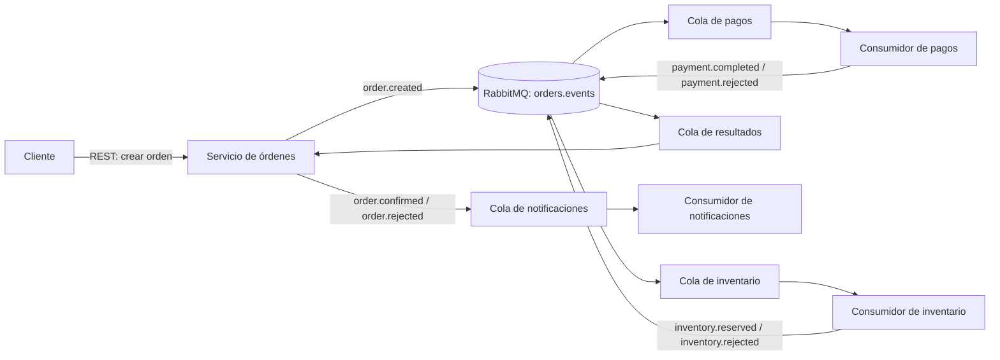

# Fase 1: Exploración y Selección del Protocolo

## Decisión

Se selecciona **AMQP 0-9-1 con RabbitMQ** para la comunicación asíncrona entre los componentes del sistema de órdenes de compra. AMQP es el protocolo de mensajería; RabbitMQ es el broker que recibe, enruta y entrega los mensajes.

La elección no implica reemplazar REST en todos los puntos. La API puede conservar REST para que el cliente cree una orden y reciba una respuesta inmediata de aceptación. El procesamiento posterior se comunica mediante eventos en RabbitMQ.

## Caso de uso

Cuando un cliente crea una orden, el sistema la registra y publica un evento `order.created`. Los servicios de pagos e inventario reciben copias independientes y procesan su parte sin mantener abierta la solicitud HTTP. Al finalizar, el servicio de órdenes publica un resultado, como `order.confirmed` o `order.rejected`, que puede consumir el servicio de notificaciones.

En RabbitMQ, el productor publica en un *exchange*, no directamente en una cola. Se propone un *topic exchange* llamado `orders.events`, con bindings para las colas durables `payments.orders`, `inventory.orders`, `orders.results` y `notifications.orders`. Las routing keys `order.created` enrutan la orden a pagos e inventario; `payment.*` e `inventory.*` enrutan sus resultados a `orders.results`; `order.confirmed` y `order.rejected` enrutan el resultado final a `notifications.orders`. Cada servicio conserva su propia cola para avanzar o reintentar de manera independiente.

## Comparación de alternativas

| Opción | Características y uso típico | Ajuste al caso de órdenes |
|---|---|---|
| REST/HTTP | Solicitud-respuesta, ampliamente compatible y fácil de exponer a clientes. | Adecuado para crear la orden y responder aceptación; menos adecuado para desacoplar trabajo largo: el cliente queda ligado a la disponibilidad y latencia del servicio receptor. |
| AMQP 0-9-1 / RabbitMQ | Mensajería con broker, exchanges, routing keys, colas, ACK y confirmaciones de publicación. | **Alto.** Permite desacoplar servicios, acumular trabajo durante picos y enrutar un evento a varios procesos independientes. |
| gRPC | RPC síncrono eficiente sobre HTTP/2, contratos con Protocol Buffers y soporte de streaming. | Bueno para llamadas internas que necesitan respuesta inmediata; el emisor y receptor siguen acoplados temporalmente y gRPC por sí solo no proporciona colas durables. |
| WebSocket | Canal bidireccional persistente, habitual para actualizaciones en tiempo real entre navegador y servidor. | Útil para informar al cliente del estado de una orden, pero no sustituye una cola durable para procesar pagos e inventario. |
| STOMP | Protocolo de mensajería sencillo, normalmente usado sobre WebSocket o con brokers compatibles. | Puede servir para mensajería, pero el proyecto requiere las capacidades de enrutamiento y gestión de colas del broker; no aporta una ventaja clara frente a AMQP aquí. |
| RSocket | Comunicación reactiva con flujos, multiplexación y control de demanda (*backpressure*). | Interesante para streams interactivos; añade complejidad y no es, por sí mismo, una cola persistente de trabajos. |
| MQTT | Publicación/suscripción ligera, diseñada especialmente para dispositivos y redes con recursos limitados. | Puede transportar eventos, pero su enfoque IoT no aporta una ventaja frente al enrutamiento de colas de AMQP para este flujo de negocio. |
| SOAP sobre Web Services | Servicios basados en XML y contratos/formalismos empresariales. | Puede ofrecer interoperabilidad en entornos heredados, pero no resuelve por sí solo el procesamiento asíncrono con cola y añade sobrecarga. |
| XMPP | Mensajería extensible, presencia y comunicación en tiempo real. | Se ajusta mejor a chat y presencia; no es la opción más directa para distribuir tareas de órdenes a consumidores de backend. |
| Webhook | Notificación HTTP enviada a un endpoint remoto cuando ocurre un evento. | Útil para integrar terceros; el emisor debe manejar disponibilidad, reintentos y entrega, y queda acoplado al endpoint del receptor. |
| GraphQL | Lenguaje y esquema para consultar y modificar datos mediante una API; puede ofrecer suscripciones. | Resuelve acceso flexible a datos, no el encolamiento durable y la distribución de trabajos. No es un sustituto directo de un broker. |

## ¿Por qué frente a REST?

RabbitMQ es preferible **para el procesamiento interno asíncrono**, no para todas las interacciones. Con REST síncrono, el servicio que recibe la solicitud debe estar disponible y completar su respuesta dentro del tiempo de espera del cliente o del servicio llamador. Con una cola, el servicio de órdenes puede aceptar el trabajo y continuar; los consumidores lo procesan cuando tienen capacidad. El broker conserva el trabajo pendiente y distribuye eventos a los servicios interesados.

Esto reduce el acoplamiento temporal y permite absorber picos de demanda, añadir consumidores y reintentar fallos transitorios sin exigir que el cliente repita la solicitud. Como contrapartida, la respuesta final deja de ser inmediata: el cliente consulta el estado de la orden o recibe una notificación posterior. También se añade infraestructura y operación del broker.

## Manejo y confiabilidad de los mensajes

- El mensaje contiene un identificador de evento, tipo/versionado, `orderId`, fecha, `correlationId` y el contenido necesario para procesarlo. No debe incluir datos de pago sensibles.
- Las colas y los mensajes importantes se configuran como durables/persistentes; el productor usa *publisher confirms* para saber si el broker aceptó la publicación.
- El consumidor envía ACK solo después de completar y guardar correctamente su operación. Si falla antes del ACK, el mensaje puede volver a entregarse.
- Las entregas son, en la práctica, **al menos una vez** cuando se usan confirmaciones y ACK apropiados; pueden existir duplicados. Los consumidores deben ser idempotentes, por ejemplo, registrando el `eventId` procesado o protegiendo la operación por `orderId`.
- Los fallos permanentes no deben entrar en un ciclo infinito de reencolado. Se definen reintentos limitados con espera y una *dead-letter queue* (DLQ) para análisis y recuperación.
- Para evitar guardar la orden en la base de datos y perder el evento si falla una de las dos operaciones, en la fase de implementación se evaluará el patrón *transactional outbox*.

AMQP/RabbitMQ **no garantiza exactamente una vez** el efecto de negocio ni un orden global entre colas. El orden, las reentregas y la concurrencia deben considerarse en el diseño de consumidores.

## Escalabilidad y trade-offs

Se puede aumentar el paralelismo levantando varias instancias consumidoras para una misma cola; RabbitMQ distribuye los mensajes entre ellas. Colas separadas para pagos e inventario permiten procesar el mismo evento en paralelo y escalar cada servicio con independencia. La cola también actúa como búfer cuando la llegada de órdenes supera temporalmente la capacidad de procesamiento.

El escalado no es ilimitado ni automático: el broker, la base de datos o un consumidor lento pueden convertirse en cuellos de botella. Deben observarse la profundidad y antigüedad de las colas, los reintentos y las DLQ; la alta disponibilidad requiere configurar y operar RabbitMQ apropiadamente. Más consumidores aumentan capacidad, pero no hacen seguras por sí solas las operaciones concurrentes sobre la misma orden.

## Plan de uso en el proyecto

1. Mantener una API REST para recibir la orden y responder con su identificador y estado inicial (`PENDING`).
2. Publicar `order.created` en `orders.events`, idealmente a partir de un *outbox* transaccional.
3. Enrutar el evento a las colas de pagos e inventario. Cada servicio lo valida, procesa de manera idempotente y confirma o rechaza su entrega.
4. El servicio de órdenes reúne los resultados y publica `order.confirmed` o `order.rejected`.
5. El servicio de notificaciones consume el resultado y avisa al cliente de forma asíncrona; el estado también queda consultable por REST.

La implementación prevista en Spring será con Spring AMQP y RabbitMQ. Esta fase documenta la selección; el broker, las colas y los consumidores se implementan en la fase siguiente.

## Fuentes

- [RabbitMQ: AMQP 0-9-1 Model Explained](https://www.rabbitmq.com/tutorials/amqp-concepts)
- [RabbitMQ: Work Queues (Java)](https://www.rabbitmq.com/tutorials/tutorial-two-java)
- [RabbitMQ: Publish/Subscribe (Java)](https://www.rabbitmq.com/tutorials/tutorial-three-java)
- [RabbitMQ: Reliability Guide](https://www.rabbitmq.com/docs/reliability)